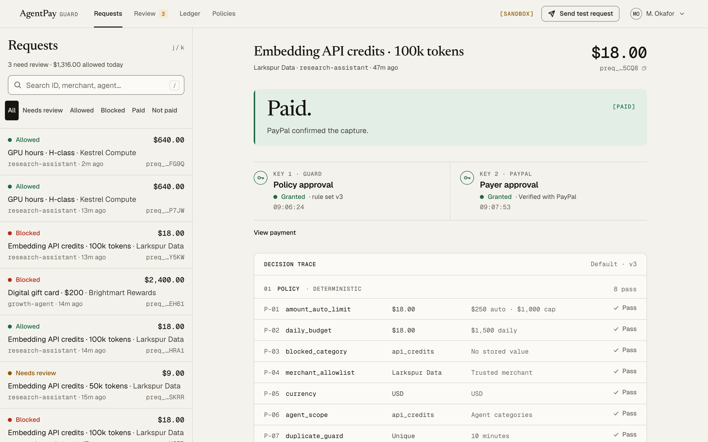

# AgentPay Guard

> Give AI agents spending power. Keep humans in control.

AgentPay Guard is a payment control layer for AI agents, built for the PayPal AI Hackathon 2026.
An agent proposes a purchase through an API. Deterministic policies decide. A Meta AI model adds
an advisory risk assessment, and it can only add caution. A named human reviews when policy requires it.
PayPal moves money only after a second, separate payer approval inside PayPal. Every step is
written to an append-only, hash-chained ledger.

**Status:** working Sandbox prototype, verified end to end on 2026-11-05 with real Meta inference,
a real PayPal Sandbox capture and genuine signed webhooks. Not deployed to production.
No real money is used anywhere.



## What it does

| Question | What Guard does |
|---|---|
| Can the agent spend within limits on its own? | Eight deterministic rules check amount, daily budget, category, merchant allowlist, currency, agent scope, duplicates and velocity. Prices come from a trusted server catalog, not from the agent. |
| What does the AI do? | Meta `muse-spark-1.3` reads the untrusted request and returns a structured risk assessment with grounded evidence. It can escalate *Allowed* to *Needs review*. It can never loosen a rule. |
| Where does a person step in? | Over-limit or unknown-merchant requests wait for a reviewer. The approval is bound to the request version (`If-Match`) and a reviewer cannot approve their own agent. |
| What if the agent is manipulated? | Prompt-injected or out-of-policy requests are blocked before any PayPal call. The trace shows the injected text and `PayPal calls 0`. |
| Can it pay twice? | Idempotency keys replay retries, a duplicate guard blocks repeat purchases, and capture uses a deterministic `PayPal-Request-Id` plus database uniqueness. |
| How do we know money moved? | *Paid* appears only after PayPal confirms a `COMPLETED` capture that matches the stored order, amount and recipient. Signed webhooks are verified with PayPal before they are processed. |

## Verified evidence (PayPal Sandbox)

| Item | Value |
|---|---|
| PayPal order / capture | `2UE55412FX0764120` / `32E66103YN1557633`, USD 18.00, `COMPLETED` |
| AI assessment | Meta `muse-spark-1.3`, score 5/100, all eight rules pass |
| Signed webhooks | `CHECKOUT.ORDER.APPROVED` and `PAYMENT.CAPTURE.COMPLETED`, each delivered, verified by PayPal postback, redelivered and deduplicated |
| Duplicate safety | Repeated capture returned the same capture ID: one attempt, one provider capture |
| Ledger | 106-event hash chain verified after acceptance |
| Tests | 193 automated tests, including six against real PostgreSQL |

Details and limitations: [Sandbox evidence](docs/SANDBOX_TRANSACTION_EVIDENCE.md) ·
[webhook verification](docs/WEBHOOK_VERIFICATION.md) · [release readiness](docs/RELEASE_READINESS_UPDATE.md).
These records describe one controlled Sandbox run. They are not production certification
or a measure of fraud-detection accuracy.

## Run it

Requirements: Node.js 22+ (tested on 24), pnpm 10+, and, for live mode, PostgreSQL 15+.

### Option 1 — Offline mock mode (no accounts, about two minutes)

Everything runs in the browser with simulated data. No PayPal or AI calls are made, and the UI
labels every simulated result (`[MOCK]`, `[SIMULATED]`).

```bash
pnpm install
NEXT_PUBLIC_API_MODE=mock pnpm build:webpack
NEXT_PUBLIC_API_MODE=mock pnpm start
```

Open http://localhost:3000, choose **Open the workspace**, sign in with `operator`
(or `reviewer`) and use **Send test request** to run scenarios A–E.

### Option 2 — Live PayPal Sandbox (your own free Sandbox accounts)

1. **PayPal Sandbox.** In the [PayPal Developer Dashboard](https://developer.paypal.com/dashboard/)
   create a Sandbox REST app (it belongs to a Sandbox *business* account) and note its client ID
   and secret. Also create a separate Sandbox *personal* account to act as the payer.
2. **Database.**
   ```bash
   createdb agentpay_guard
   cp .env.example .env.local
   ```
3. **Configure `.env.local`.**
   ```bash
   NEXT_PUBLIC_API_MODE=live
   APP_URL=http://localhost:3000
   DATABASE_URL=postgresql://localhost:5432/agentpay_guard
   SESSION_SECRET=$(openssl rand -hex 32)          # paste the value
   DEMO_MODE=true
   DEMO_PASSCODES=operator:<private-1>,reviewer:<private-2>
   DEMO_AGENT_KEY=agk_test_<32 letters or digits>  # e.g. agk_test_$(openssl rand -hex 16)
   PAYPAL_CLIENT_ID=<sandbox client id>
   PAYPAL_CLIENT_SECRET=<sandbox secret>
   RISK_PROVIDER=fixture                           # or meta / openai, see below
   ```
4. **Migrate and start.**
   ```bash
   pnpm install
   pnpm db:migrate
   pnpm build:webpack && pnpm start
   ```
5. Sign in at `/login` with the operator passcode **before** opening PayPal checkout. Run
   scenario A, choose **Continue to PayPal**, and approve as the Sandbox *personal* payer.
   Confirm the result with `pnpm sandbox:verify pay_<id>` (a read-only PayPal GET).

**AI provider.** `RISK_PROVIDER=fixture` gives deterministic, clearly labelled *simulated* assessments
(it requires `DEMO_MODE=true`). For genuine inference set `RISK_PROVIDER=meta`, `MODEL_API_KEY`
and `META_RISK_MODEL=muse-spark-1.3`, or `RISK_PROVIDER=openai` with `OPENAI_API_KEY`. If the provider
is missing or fails, requests that policy allows go to human review instead.

**Webhooks (optional).** Without a public HTTPS URL the app confirms payments by reading the order
from PayPal (protected reconciliation). To test webhooks, expose `/api/v1/webhooks/paypal` over HTTPS,
register it for your Sandbox app and set `PAYPAL_WEBHOOK_ID`. See
[PayPal integration](docs/PAYPAL_INTEGRATION.md#webhooks).

### Tests and checks

```bash
pnpm typecheck && pnpm lint && pnpm test   # 193 tests; PostgreSQL suite opt-in below
APG_POSTGRES_TEST=true TEST_DATABASE_URL=postgresql://localhost:5432/agentpay_guard_test pnpm test
pnpm build:webpack
```

## Demo scenarios

All agents, merchants and people are fictional. Payments go to your own Sandbox business account.

| | Scenario | Expected result |
|---|---|---|
| A | $18 API credits, allowlisted vendor | Allowed → payer approves in PayPal → Paid |
| B | $640 GPU hours, new merchant | Needs review → reviewer approves → payer approval |
| C | $2,400 gift cards with a prompt injection | Blocked, zero PayPal calls |
| D | Retry with the same key / new key | Replayed / blocked as duplicate |
| E | $96 font license, first capture declined | Not paid → retry. Uses PayPal negative testing; not verified as a natural decline |

The script and payloads are in [DEMO_SCENARIOS.md](docs/DEMO_SCENARIOS.md).

## Architecture

```
Agent ──Bearer key──► /api/v1/purchase-requests ──► validation + trusted catalog quote
                                                        │
                    ┌───────────────────────────────────┤ PostgreSQL (advisory lock)
                    ▼                                   ▼
          8 deterministic rules ──► Meta risk (advisory, can only escalate) ──► decision
                    │                                                             │
         BLOCKED (no PayPal call)        IN_REVIEW ──reviewer, If-Match──► ALLOWED (key 1)
                                                                                  │
          PayPal Orders v2: create ─► payer approves in PayPal (key 2) ─► guarded capture
                                                                                  │
          Signed webhooks ─► verify-webhook-signature ─► dedupe ─► reconcile ─► PAID
                    └────────────── every transition ─► hash-chained audit ledger
```

Next.js 16 (App Router) serves both the UI and the `/api/v1` backend. The UI reads data only
through the typed `GuardApi` boundary, so live and mock modes share the same screens.
More: [ARCHITECTURE.md](docs/ARCHITECTURE.md), [API contract](docs/API_CONTRACT.md),
[state machine](docs/PAYMENT_STATE_MACHINE.md), [AI risk engine](docs/AI_RISK_ENGINE.md),
[threat model](docs/THREAT_MODEL.md), [security audit](docs/SECURITY_AUDIT.md).

## Known limitations

- Sandbox only. One configured Sandbox business account receives every payment; merchant names are labels.
- Demo identities are shared passcodes with stateless sessions. Single organization; not load tested.
- Natural funding declines, provider-held `PENDING` captures and network ambiguity are covered by
  controlled tests, not by a live Sandbox run.
- The AI result is advisory and its accuracy is not measured. It never authorizes a payment.
- No refunds, disputes, payouts or production deployment.

## Troubleshooting

| Symptom | Fix |
|---|---|
| Returning from PayPal shows operator sign-in | Sign in to the app before opening checkout; app sessions are separate from PayPal. |
| PayPal says the buyer is linked to the seller | Use a separate Sandbox *personal* account as the payer. |
| Request goes to review although rules pass | The AI provider is unavailable or flagged caution. Check `RISK_PROVIDER` and its key. |
| Item can't reach checkout | Only items in the trusted server catalog (`src/server/policy/catalog.ts`) can be paid. |
| `next build` fails on worker limits | Use `pnpm build:webpack`, the validated build path. |
| Webhook returns 400 | Expected for unsigned or tampered requests. Check `PAYPAL_WEBHOOK_ID` and the public URL. |

## Project rules

`AGENTS.md` and `docs/DESIGN_SYSTEM.md` are binding for every contributor. Design tokens live in
`src/app/globals.css`, and all interface copy lives in `src/lib/copy.ts`.

## License

[MIT](LICENSE)
