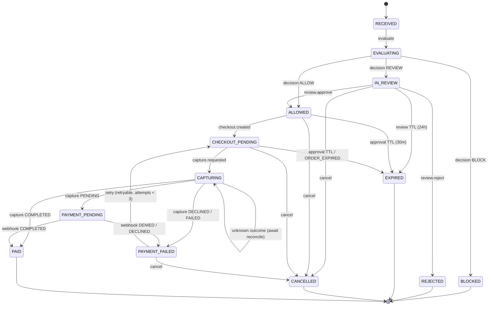
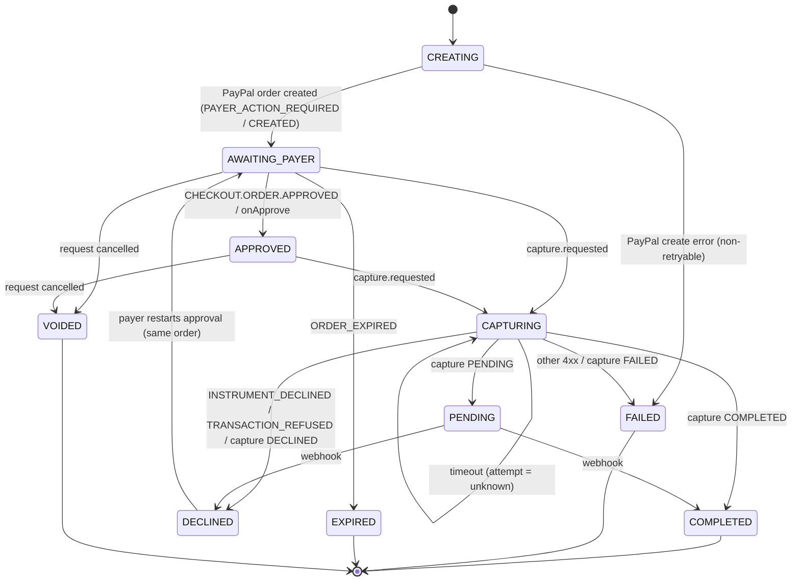

# Payment State Machine

Normative. Implement transitions in **one module** (`src/server/state/transitions.ts`) as pure functions:
`transition(entity, event) → { next, effects[] } | TransitionError`.
Route handlers, webhooks and reconciliation **must** all go through it. No direct `status =` writes anywhere else.

There are two linked machines:
- **PurchaseRequest**: the decision lifecycle plus the aggregated payment phase.
- **Payment**: one PayPal order and its capture attempts. A request has 0..n payments, and at most **one open** payment at a time.

---

## 1. PurchaseRequest machine



### 1.1 Status definitions

| Status | Meaning | Policy key | Payer key | Terminal |
|---|---|---|---|---|
| `RECEIVED` | Validated and persisted | waiting | not_applicable | |
| `EVALUATING` | Policy and risk running | waiting | not_applicable | |
| `IN_REVIEW` | Needs a human reviewer | waiting | not_applicable | |
| `ALLOWED` | Policy approval granted (auto or by a reviewer). No PayPal order yet | **granted** | waiting | |
| `BLOCKED` | Denied by deterministic policy. **Zero PayPal calls.** | denied | not_applicable | ✔ |
| `REJECTED` | Denied by a reviewer | denied | not_applicable | ✔ |
| `CHECKOUT_PENDING` | PayPal order exists. Waiting for payer approval or capture | granted | waiting | |
| `CAPTURING` | Capture call in flight or outcome unknown | granted | granted | |
| `PAID` | PayPal capture `COMPLETED` | granted | granted | ✔ |
| `PAYMENT_PENDING` | PayPal capture `PENDING` (held by PayPal) | granted | granted | |
| `PAYMENT_FAILED` | Capture declined or failed. **No money moved.** | granted | waiting (if retryable) / denied | |
| `EXPIRED` | Review or policy-approval window elapsed | — | — | ✔ |
| `CANCELLED` | Withdrawn by agent or operator before payment | — | — | ✔ |

### 1.2 Transition table (with guards and effects)

| From | Event | Guard | To | Effects (audit events) |
|---|---|---|---|---|
| — | `create` | valid body, amount = Σ items, USD | `RECEIVED` | `request.received` |
| `RECEIVED` | `evaluate` | — | `EVALUATING` | — |
| `EVALUATING` | `decided(ALLOW)` | combine() = ALLOW | `ALLOWED` | `policy.evaluated`, `risk.assessed`, `decision.made`; set `expires_at = now+30m` |
| `EVALUATING` | `decided(REVIEW)` | combine() = REVIEW | `IN_REVIEW` | same; `review_expires_at = now+24h` |
| `EVALUATING` | `decided(BLOCK)` | combine() = BLOCK | `BLOCKED` | same (+ `request.duplicate_detected` if P-07) |
| `IN_REVIEW` | `review.approve` | role = reviewer, `If-Match` ok, not self-owned | `ALLOWED` | `review.approved`; `expires_at = now+30m` |
| `IN_REVIEW` | `review.reject` | role = reviewer, note ≥ 3 chars | `REJECTED` | `review.rejected` |
| `ALLOWED` | `checkout.created` | `now < expires_at` | `CHECKOUT_PENDING` | `checkout.created` |
| `CHECKOUT_PENDING` | `capture.requested` | `now < expires_at`, open payment ∈ {AWAITING_PAYER, APPROVED} | `CAPTURING` | `payment.capture_requested` |
| `CAPTURING` | `capture.completed` | — | `PAID` | `payment.completed` |
| `CAPTURING` | `capture.pending` | — | `PAYMENT_PENDING` | `payment.pending` |
| `CAPTURING` | `capture.declined` / `capture.failed` | — | `PAYMENT_FAILED` | `payment.declined` / `payment.failed` |
| `PAYMENT_PENDING` | webhook `completed` / `denied` | signature verified | `PAID` / `PAYMENT_FAILED` | `webhook.received`, `payment.*` |
| `PAYMENT_FAILED` | `retry` (= checkout) | `failure.retryable`, attempts < 3, `now < expires_at`* | `CHECKOUT_PENDING` | `checkout.created` (resume or new order) |
| `IN_REVIEW`/`ALLOWED`/`CHECKOUT_PENDING`/`PAYMENT_FAILED` | `cancel` | agent owns it, or operator | `CANCELLED` | `request.cancelled`; open payment → `VOIDED` |
| `ALLOWED`/`CHECKOUT_PENDING` | `tick` | `now ≥ expires_at` | `EXPIRED` | `request.expired` |

\* When a reviewer-approved request fails at capture, the 30-minute approval window is **extended once by 15 minutes** on the first retry. This keeps the demo recovery path from expiring mid-presentation.

Expiry is evaluated **lazily** on read and before every mutation (no cron needed). An optional sweeper may also run.

Every other (status, event) pair → `409 STATE_CONFLICT` with `allowed_from`.

---

## 2. Payment machine



### 2.1 Request ⇄ Payment status projection

| Payment status | Request status |
|---|---|
| `CREATING`, `AWAITING_PAYER`, `APPROVED` | `CHECKOUT_PENDING` |
| `CAPTURING` | `CAPTURING` |
| `COMPLETED` | `PAID` |
| `PENDING` | `PAYMENT_PENDING` |
| `DECLINED`, `FAILED` | `PAYMENT_FAILED` |
| `EXPIRED` | `PAYMENT_FAILED` (retryable → creates a **new** order) or `EXPIRED` if policy approval also lapsed |
| `VOIDED` | `CANCELLED` |

Request and payment status are updated **in one database transaction**.

---

## 3. PayPal mapping

### 3.1 Order creation
| PayPal response | Our result |
|---|---|
| `201`/`200`, status `PAYER_ACTION_REQUIRED` or `CREATED` | Payment `AWAITING_PAYER`, store `payer_action_url` (`rel: payer-action`, else `approve`) |
| 5xx / network error | Retry the same `PayPal-Request-Id` up to 2× (backoff 300ms, 900ms). Then `503 PAYPAL_UNAVAILABLE`, payment stays `CREATING` (a retry reuses the same `PayPal-Request-Id`, so there is never a second order) |
| 4xx | Payment `FAILED`, `failure.code = PAYPAL_ERROR`, store `debug_id` |

### 3.2 Payer approval
- JS SDK `onApprove({ orderID })` → the client calls capture immediately.
- Redirect fallback: `/checkout/return?payment=…&token=<orderID>` → server-side capture.
- `onCancel` / `/checkout/cancel` → audit `payer.cancelled`. **Status unchanged** (`AWAITING_PAYER`), because the same order can be approved later.

### 3.3 Capture result mapping
| PayPal result | Attempt | Payment | `failure` |
|---|---|---|---|
| `201`, capture `COMPLETED` | completed | `COMPLETED` | null |
| `201`, capture `PENDING` | pending | `PENDING` | null |
| `201`, capture `DECLINED` or `FAILED` | declined/failed | `DECLINED`/`FAILED` | `PAYMENT_DECLINED`, retryable = (attempts < 3) |
| `422 INSTRUMENT_DECLINED` | declined | `DECLINED` | `PAYMENT_DECLINED`, retryable, message "PayPal declined the funding source. No payment was taken." |
| `422 TRANSACTION_REFUSED` | declined | `DECLINED` | same, retryable |
| `422 PAYER_ACTION_REQUIRED` / `ORDER_NOT_APPROVED` | failed | back to `AWAITING_PAYER` | `PAYER_ACTION_REQUIRED`, retryable |
| `422 ORDER_ALREADY_CAPTURED` | completed | `GET` order → `COMPLETED` | null (idempotent success) |
| `422 DUPLICATE_INVOICE_ID` | failed | `FAILED` | `PAYPAL_ERROR`, not retryable. Investigate, since a duplicate payment was prevented |
| `422 MAX_NUMBER_OF_PAYMENT_ATTEMPTS_EXCEEDED` | failed | `FAILED` | `ATTEMPTS_EXCEEDED`, not retryable on this order. Retry creates a new order |
| `404`/`422 ORDER_EXPIRED` | failed | `EXPIRED` | `ORDER_EXPIRED`, retryable via new order |
| Timeout / 5xx | unknown | stays `CAPTURING` | null. UI shows "Confirming with PayPal…" and calls `/reconcile` |

### 3.4 Retry after decline (scenario E)
1. The payment is `DECLINED` and the request is `PAYMENT_FAILED` with `next_actions: ["retry_payment","cancel"]`.
2. "Try payment again" calls `POST /checkout`. The server returns the **same** payment and order, and moves the payment to `AWAITING_PAYER` (PayPal's guidance for `INSTRUMENT_DECLINED` is to send the payer back to approval on the same order).
3. The payer re-approves in PayPal and the client calls `/capture` again → attempt n+1 with `PayPal-Request-Id: cap_<payment>_<n+1>`.
4. If the order is unusable (`EXPIRED`, `ATTEMPTS_EXCEEDED`), `POST /checkout` creates a **new** payment and order. The old one is marked `VOIDED`. There is still only one open payment.

---

## 4. Decision logic

### 4.1 Policy set `Default · v3` (deterministic, seeded)

| ID | Key | Rule | Outcome |
|---|---|---|---|
| P-01 | `amount_auto_limit` | amount ≤ $250 → pass; ≤ $1,000 → review; > $1,000 → block | pass/review/block |
| P-02 | `daily_budget` | agent's (paid + reserved) today + amount ≤ $1,500 → pass; else review | pass/review |
| P-03 | `blocked_category` | category ∈ {gift_cards, crypto, money_transfer, gambling} → block | pass/block |
| P-04 | `merchant_allowlist` | merchant not on org allowlist → review | pass/review |
| P-05 | `currency` | not USD → block (unreachable via validation; kept for completeness) | pass/block |
| P-06 | `agent_scope` | category ∉ agent.allowed_categories → review | pass/review |
| P-07 | `duplicate_guard` | same fingerprint within 10 min, not terminal-denied → block | pass/block |
| P-08 | `velocity` | > 5 requests from this agent in 10 min → review | pass/review |

**Reserved** = amounts of this agent's requests in `IN_REVIEW`, `ALLOWED`, `CHECKOUT_PENDING`, `CAPTURING`, `PAYMENT_PENDING` created today (PST). This prevents budget races.

All 8 rules are always evaluated and returned, even after a `block`, so the trace explains the decision completely.

### 4.2 Combination (the "one-way valve")

```ts
function combine(policy: RuleOutcome[], risk: RiskAssessment): DecisionOutcome {
  const policyOutcome =
    policy.includes("block") ? "BLOCK" :
    policy.includes("review") ? "REVIEW" : "ALLOW";

  if (policyOutcome !== "ALLOW") return policyOutcome;          // AI cannot relax rules

  if (risk.status !== "completed") return "REVIEW";             // fail safe, not fail open
  if (risk.recommendation === "escalate_to_review") return "REVIEW";
  if ((risk.score ?? 100) >= 35) return "REVIEW";                // medium/high ⇒ human
  return "ALLOW";
}
```

Invariants:
- **AI can never produce ALLOW from REVIEW/BLOCK, and can never produce BLOCK.** Only rules block.
- `risk_escalated = (policyOutcome === "ALLOW" && outcome === "REVIEW")`.
- When AI is unavailable, nothing is auto-allowed. Everything that would have been allowed goes to a human.

---

## 5. Concurrency and idempotency invariants

1. **At most one open payment per request**: a partial unique index on `payments(purchase_request_id) WHERE status IN ('CREATING','AWAITING_PAYER','APPROVED','CAPTURING','PENDING')`.
2. **At most one capture in flight**: a conditional update (`WHERE status IN (...)`) is the lock.
3. **PayPal idempotency**: `PayPal-Request-Id` is deterministic (`ord_<payment_id>`, `cap_<payment_id>_<n>`), so network retries never create a second order or capture.
4. **API idempotency**: `Idempotency-Key` replay (`API_CONTRACT.md §0.2`).
5. **Semantic duplicates**: P-07 fingerprint guard.
6. **PayPal-side guard**: `invoice_id = purchase_request_id`.
7. **Optimistic concurrency**: `version` increments on every transition. Reviews require `If-Match`.
8. **Audit append-only**: an `audit_events` insert happens in the same transaction as the state change. `seq` is gap-free, and each event's `hash = sha256(prev_hash ‖ canonical_json(event))`.

## 6. Invariant tests (must exist before UI integration)

| # | Test |
|---|---|
| T1 | A BLOCKED request: PayPal client mock receives **0** calls across create, checkout, capture and webhook attempts |
| T2 | Same `Idempotency-Key` ×2 on create → 1 row, same body, second response has `Idempotent-Replayed: true` |
| T3 | Different key, same payload within 10 min → second request `BLOCKED` with `duplicate_of` = first |
| T4 | Two concurrent `/capture` calls → exactly 1 PayPal capture call; the other gets `409 CAPTURE_IN_PROGRESS` or the replayed result |
| T5 | `INSTRUMENT_DECLINED` → `PAYMENT_FAILED`, retry → `CHECKOUT_PENDING` on the same order → capture → `PAID`, with 2 attempts recorded |
| T6 | Risk `unavailable` + policy ALLOW → `REVIEW` |
| T7 | Risk score 5 + policy REVIEW → still `REVIEW`. Risk score 95 + policy ALLOW → `REVIEW` (not BLOCK) |
| T8 | Review with stale `If-Match` → `412` |
| T9 | Capture after `expires_at` → `409 POLICY_APPROVAL_EXPIRED` |
| T10 | Audit chain verify passes after the full scenario run, and fails after a manual row edit |

## 7. Implementation clarifications (2026-11-03)

Evaluation persists EVALUATING and its policy snapshot before external AI I/O, releasing the
database lock. EVALUATING requests reserve daily budget while in flight. An evaluation lease
expires after ten seconds; lazy reads/mutations settle abandoned evaluations conservatively
using the saved policy and unavailable risk. Late model responses cannot overwrite that decision.
Create idempotency records retain the resource ID across lease recovery, preventing a second
purchase after interruption. Model failures never silently select fixture mode.

`CREATING` is persisted while its request remains ALLOWED until order creation succeeds; a definitive create failure projects PAYMENT_FAILED. Creating orders cannot be cancelled or expired until their result is reconciled. A safe order GET reporting CREATED/PAYER_ACTION_REQUIRED never grants the payer key. Mapping PAYER_ACTION_REQUIRED after capture returns request CHECKOUT_PENDING and payment AWAITING_PAYER. Definitive create failure allows cancellation. Payment cancellation also accepts DECLINED/FAILED/EXPIRED (local abandonment, no invented PayPal void API).

Reconciliation may recover an interrupted create using the identical create ID; it may settle a matching captured order after policy expiry (settlement records money already moved). It never initiates a new capture after approval expiry. An unknown capture stays CAPTURING until a verified outcome; expiry cannot overwrite it. PENDING may resolve to FAILED as well as DECLINED/COMPLETED. Refund statuses are never translated into a fresh successful payment.
