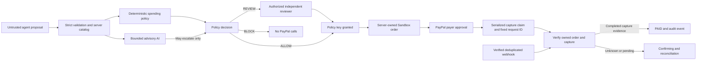

# Threat model

2026-11-04 · Single-organization, USD, PayPal Sandbox application. This model
describes the reviewed implementation and its explicit assumptions; release
readiness is recorded in [RELEASE_BLOCKERS.md](RELEASE_BLOCKERS.md).

## Assets and principals

Protect payer funds, immutable purchase amount/quote, policy and reviewer approval,
PayPal order/capture ownership, financial state, API idempotency records, audit
history, provider secrets and session/agent credentials.

| Principal | Authority | Treat as untrusted |
|---|---|---|
| Anonymous visitor | Landing/sign-in; provider-signed webhook delivery | Every request, header and claimed role |
| Agent with valid key | Propose, read own resources, cancel own eligible early request | Text, metadata, money, merchant and approval claims |
| Operator | Read organization data, checkout/capture/reconcile, eligible cancel/demo operations | Browser-supplied amount, order ID, success/return parameters |
| Reviewer | Operator abilities plus review of another owner's IN_REVIEW request | Approval replays, stale version, self-ownership claims |
| PayPal payer | Approves the bound order in Sandbox | Redirect/browser SDK claims of completion |
| Risk provider | Advisory assessment; cannot authorize or call payment tools | Model output and agent text embedded in its input |
| PayPal API/webhook | Authenticated financial observations | Malformed, delayed, replayed or contradictory responses |
| Server/DB administrator | Trusted configuration and storage authority | Outside protection against hostile server/DB takeover |

An attacker may hold a real agent key, send arbitrary HTTP/JSON, race operations,
repeat old messages, manipulate free text, or control a browser. Tests also model
provider faults and lost responses. A stolen reviewer credential already confers
reviewer authority; this repository is not an identity-provider or account-recovery
system. Two colluding authorized humans plus a payer are outside agent-only
authorization guarantees.

## Boundaries and flow

The policy key and payer key are independent. Neither ALLOWED, human approval,
order creation nor browser onApprove means PAID. Only a verified capture for the
stored request, order, merchant, USD amount and final state can complete payment.
The configured Sandbox merchant receives the payment; catalog merchants/items
are demo purchase context, not a marketplace payout integration.

## STRIDE analysis

| Threat | Existing/fixed controls | Residual assumption or limit |
|---|---|---|
| Spoofing an agent/reviewer | Hashed agent keys; HMAC session; fixed server-side role lookup; CSRF; reviewer/owner check | Private passcodes, protected signing secret and HTTPS; shared demo identities are not production IAM |
| Tampering with money/order | Strict Zod inputs, positive integer-cent sum, immutable proposal, trusted catalog, fixed payee, full order/request/capture binding | Catalog/admin/PayPal transport trusted; valid real-provider identifiers still need acceptance |
| Repudiating review/payment | Correlated append-only events, reviewer note/version, attempt IDs, DB trigger/hash chain, persisted API snapshots | DB superuser can alter chain and data; no external timestamp/anchor or offsite retention proof |
| Information disclosure | Server-only credentials; public client ID only; bounded/redacted provider input; sanitized events/errors; no payer body persistence | Organizational readers see shared data; no tenant isolation, storage encryption or deployed-log inspection was available |
| Exhaustion/races | Body bounds, auth rate limits, inference deadline, short DB transactions, capture/create claims, backoff, idempotency and unique ownership | Single global lock/full-state reads limit scale; database/auth infrastructure availability and ingress limits not load-tested |
| Privilege escalation through LLM | No tools, strict structured output, bounded evidence, instruction-pattern escalation, deterministic BLOCK cannot be relaxed | Semantic injection detection is incomplete; subjective scores are not calibrated fraud probabilities |
| Financial inconsistency | Unknown outcomes remain unknown; same attempt ID replay; verified read settles; stale metadata version checks | Eventual reconciliation needs a reachable provider and an active caller/webhook; no background settlement worker |
| Forged/replayed webhook | PayPal signature postback, certificate URL allowlist, raw-event preservation, durable event ID dedup, GET-owned-order verification | Genuine signature delivery/subscription unverified; no local independent certificate verifier is shipped |

## Payment and recovery invariants

1. BLOCKED and unapproved IN_REVIEW requests cannot create/capture payments.
2. Reviews require reviewer authority, a different owner and the current version;
   REJECTED cannot transition through another approve operation.
3. Money, currency, merchant and item quote cannot be patched after evaluation.
   Unknown catalog proposals can be reviewed but cannot be paid without a trusted
   server quote.
4. Open claims, budget reservations and reviews are serialized in PostgreSQL;
   at most one open payment and one owner of an order/capture exist.
5. Every capture attempt has a deterministic persisted PayPal request ID. An
   ambiguous original attempt is never replaced because its replay failed.
6. Timeouts, pending capture and invalid provider evidence never claim Paid or
   confirm that no money was taken. Cancellation/replacement is unavailable while
   a capture is ambiguous. Verified later completion can recover it.
7. A signed webhook is a reconciliation trigger, not settlement evidence itself.
   Replaying the event cannot introduce another capture attempt.
8. The frontend requires agreement between request/payment and capture evidence.
   Return URL parameters, SDK callbacks and optimistic review states are not proof.

API idempotency is retained for 24 hours; business claims and provider IDs remain
stored separately. Capture replay is limited to the existing five-hour recovery
window and valid policy decision. After that window the system may continue to
read/reconcile but must not invent a fresh capture ID. Unresolved outcomes need
operator investigation rather than reset/resubmit.

## Deployment assumptions and disclosed limits

- `PAYPAL_API_BASE` is pinned to Sandbox; alternate/live endpoints are rejected.
  `APP_URL` requires HTTPS except localhost, and controls Secure cookie flags.
- Demo sign-in/scenarios require explicit `DEMO_MODE=true`. Both operator and
  reviewer passcodes must remain private and distinct. A public reviewer passcode
  would deliberately expose authorized Sandbox actions. Anonymous public
  demonstration should use the explicitly labelled mock mode.
- `TRUST_PROXY=false` uses a shared login limiter. Enabling it assumes ingress
  overwrites forwarded IP headers; a direct untrusted forwarded header is not an
  acceptable deployment. Ingress was not supplied or tested.
- Signed sessions last eight hours. Logout deletes browser cookies; it does not
  revoke a copied token on the server. Secret rotation invalidates all sessions.
  Immediate per-session revocation and managed user lifecycle are not implemented.
- The provider adapter stamps current prompt/time metadata. Server code/provider
  compromise could still supply stale but structurally valid assessments. Missing,
  malformed, late or client-forged AI results fail closed in executed tests; genuine
  model quality and semantic adversarial coverage remain unverified.
- Hash-chain verification detects tested row tampering, not a hostile database
  administrator rewriting the complete chain. No audit of backups, least-privilege
  deployment grants, external logging or secret storage is claimed.
- A database that ran the old capture code may contain terminal outcomes that the
  corrected code cannot safely reinterpret automatically. Review historical FAILED,
  EXPIRED and malformed COMPLETED records against PayPal before any resubmission.

See [SECURITY_AUDIT.md](SECURITY_AUDIT.md) for reproduced findings and
[TEST_EVIDENCE.md](TEST_EVIDENCE.md) for the precise controlled/live boundary.
